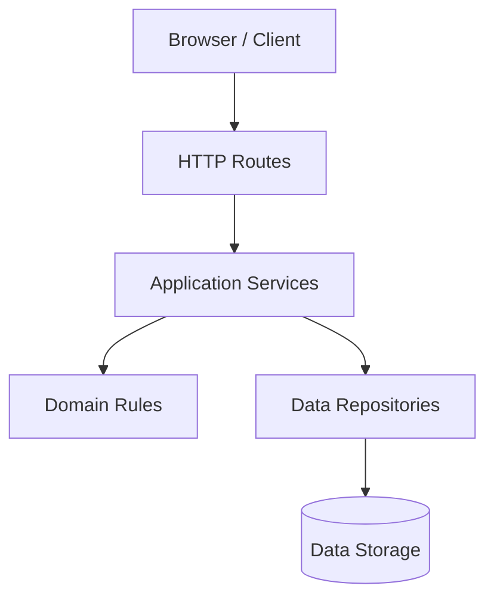
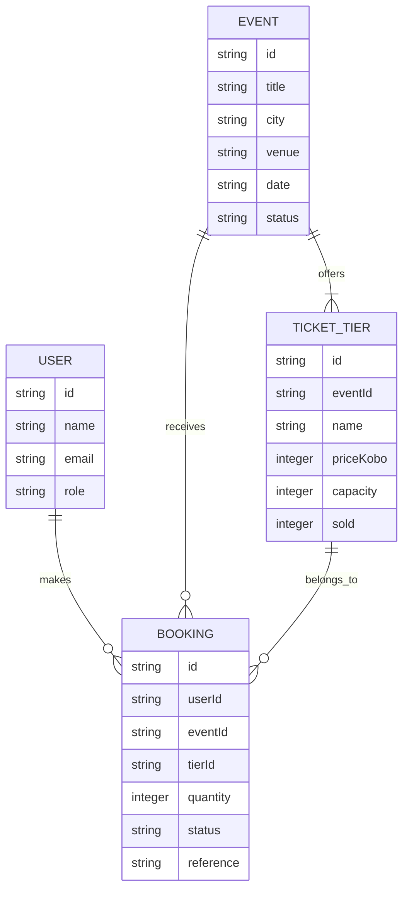
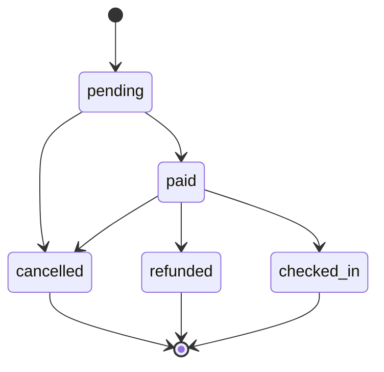

# Build 3: Application Architecture

## 1. Layered Architecture

### Layer responsibilities

- **Routes:** Handle HTTP requests, validate request shape, call services, and return HTTP responses. They must not contain business rules or directly access storage.
- **Services:** Coordinate application operations by calling domain rules and repositories. They must not handle HTTP response formatting.
- **Domain rules:** Enforce business constraints, including booking-state transitions. They must not depend on HTTP, routes, or storage.
- **Repositories:** Read and write application data. They must not decide business rules or call routes.
- **Data storage:** Holds application records. It does not call application layers.

## 2. Data Model

## 3. Booking Life Cycle

### Booking transition rules

| Current state | Allowed next states |
|---|---|
| pending | paid, cancelled |
| paid | checked_in, refunded, cancelled |
| cancelled | None |
| refunded | None |
| checked_in | None |

Any transition not listed above must be rejected with `INVALID_TRANSITION`.

## 4. HTTP Server

- The server uses Node.js built-in `node:http`.
- `GET /health` returns `{"status":"ok"}`.
- Unknown `/api` routes return a JSON 404.
- Invalid JSON returns a JSON 400.
- Errors use the shape `{"error":{"code":"...","message":"..."}}`.
- Static files are served from `public/`; paths must not escape that directory.
- The port comes from `PORT`, defaulting to `3000`.
